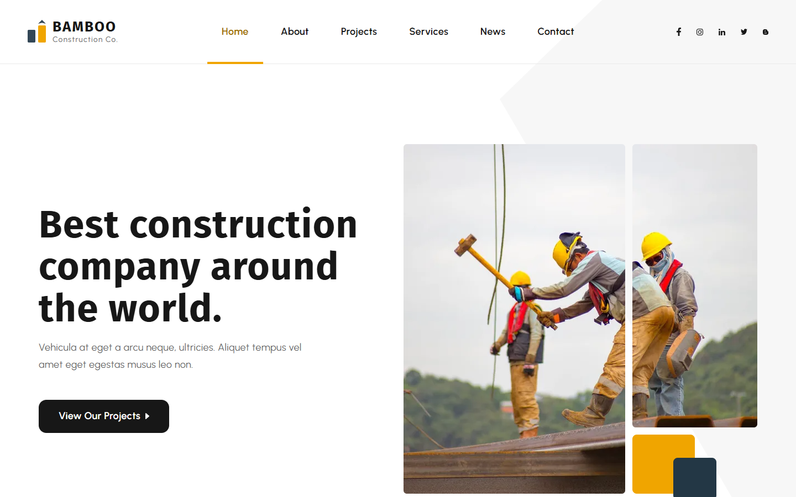
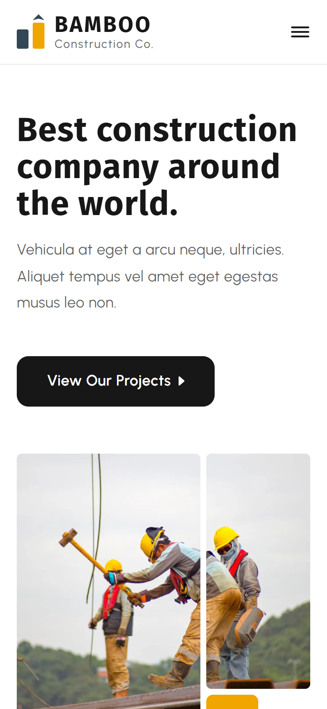

# Bamboo Construction Co.

A Figma design turned into a fast, accessible, multi-page website.

**Live site:** https://idento.github.io/bamboo-construction/

| Desktop | Mobile |
| --- | --- |
|  |  |

## The design

The Figma file contains one desktop home page (1920 px wide). Everything else was built on top of it:

- **Home page**: reproduced from the design. Checked by measuring the position of each block in the browser against the Figma coordinates at 1920 px: headings, text, images and buttons land within 1 px. Two deliberate differences: the call to action button is centered (the design offsets it by 8 px) and the carousel shows one dot per reachable position.
- **Responsive version**: the design has no tablet or mobile frame. I designed them: menu button under 1200 px, layouts that stack, a swipeable project carousel, fluid type sizes.
- **Five extra pages** in the same style: About, Services, Projects, News, Contact, plus a terms and privacy page. They reuse the design's components (section titles, cards, buttons, call to action).

## What was done

**Accessibility**
- Text contrast meets WCAG AA. Two colors of the design were too light for text on white (orange `#f0a500` at 2.08:1, grey `#a7a7a7` at 2.41:1): they were darkened just enough for text, and kept as they are for bars, lines and icons.
- Every page works with the keyboard: skip link, visible focus, menu that closes with Escape, real buttons for filters and sliders.
- Meaningful alternative text on every photo, decorative images hidden from screen readers.
- No autoplay. Animations are disabled for people who ask for reduced motion.
- Contact form with labels, error messages linked to their fields, and a status message read by screen readers.

**Performance**
- Static HTML and CSS. At most 2.2 kB of JavaScript per page, inlined (menu, project filter, carousel, testimonial slider, form check).
- Images converted to WebP at build time, in several sizes, so each screen downloads the size it needs. Only the images of the first screen load immediately, the others when the visitor scrolls to them.
- Fonts hosted with the site (no request to an outside font service), split by character set so only what the page uses is downloaded.
- Lighthouse, measured on the live site on TODO date: TODO.

**Interactions**
- Project filter by category (All, Buildings, Interior & Exterior, Renovate, Industry, Road).
- Project carousel with dots, swipeable on mobile.
- Testimonial slider with five testimonials.

## Stack

- [Astro](https://astro.build) 7, static output, strict TypeScript
- HTML, CSS (custom properties, Grid, Flexbox), vanilla TypeScript
- `astro:assets` for image optimization
- Fira Sans and Urbanist from [Fontsource](https://fontsource.org)
- GitHub Pages, deployed with GitHub Actions

## Run locally

```sh
npm install
npm run dev
```

`npm run check` runs the type checks and a production build.

## Credits

- Design: [Bamboo, Construction Company Free Website Design Template](https://www.figma.com/community/file/1513494000812520595/bamboo-construction-company-free-website-design-template) by [TemplatesJungle](https://templatesjungle.com), licensed under [CC BY 4.0](https://creativecommons.org/licenses/by/4.0/). Changes: responsive layouts, extra pages, contrast adjustments.
- Photos: the stock photos included in the design file (Unsplash and Pexels, according to the layer names).
- Bamboo Construction Co. is a fictional company. The texts are placeholders from the design or written for this demo.
- Code: Maxime Tsouri.
